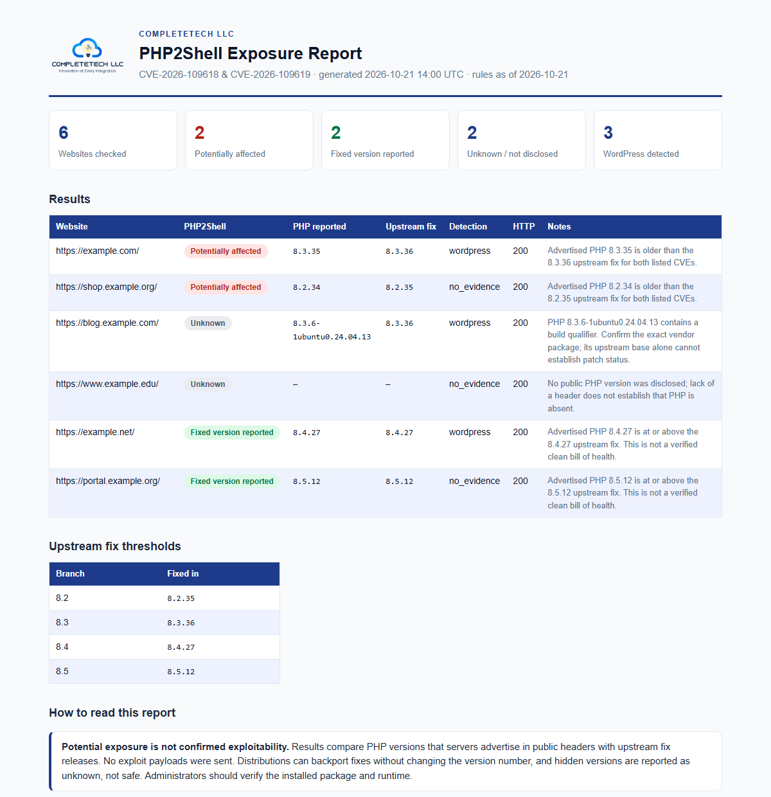

<p align="center">
  
</p>

<h1 align="center">php2shell-check</h1>

<p align="center">
  <a href="https://github.com/CompleTetech-Security/php2shell-check/actions/workflows/tests.yml"></a>
  <a href="https://github.com/CompleTetech-Security/php2shell-check/releases"></a>
  
  
  <a href="LICENSING.md"></a>
</p>

<p align="center">
  <b>Passive triage for websites that advertise a PHP version affected by PHP2Shell</b><br>
  CVE-2026-109618 · CVE-2026-109619 · single-file, dependency-free
</p>

---

## Overview

`php2shell-check` reads the PHP version a website already advertises in its public response headers and compares it with the official upstream fix for each PHP branch. It sends **no exploit payloads**, respects `robots.txt`, and reports uncertainty honestly: a hidden, conflicting or vendor-built version is `unknown`, never "safe".

- **Passive:** one ordinary page request per target, after reading `robots.txt`, with verified TLS and a descriptive User-Agent.
- **Evidence, not proof:** advertised versions are not verified runtime state. Every result records `php2shell_exploitability=not_tested`.
- **Offline-capable reports:** CSV, JSON, or a self-contained HTML report. Interrupted runs can be rendered offline from a durable checkpoint.
- **Single file:** `wordpress_check.py` uses only the Python standard library. The filename and default User-Agent are retained for compatibility; WordPress is not required for the PHP2Shell assessment.

> [!IMPORTANT]
> **Potential exposure is not confirmed exploitability.** Headers cannot reveal the PHP SAPI, vendor backports, or real patch status. Treat every result as a prompt for an administrator to check. Check only websites you are authorized to assess.

## Contents

- [Quick start](#quick-start)
- [Interpreting results](#interpreting-results)
- [What the checker requests](#what-the-checker-requests)
- [Usage](#usage)
- [Reports, checkpoints and recovery](#reports-checkpoints-and-recovery)
- [Report provenance](#report-provenance)
- [Limitations and responsible use](#limitations-and-responsible-use)
- [Agent skill](#agent-skill)
- [Documentation](#documentation)
- [Development](#development)
- [License](#license)

## Quick start

Requires Python 3.10 or newer on Windows, macOS, or Linux. There is nothing to install: no `pip` package, API key, browser, or database. Use `python3` where that is how Python is named on your system.

```sh
git clone https://github.com/CompleTetech-Security/php2shell-check.git
cd php2shell-check

python wordpress_check.py example.com                       # CSV to the terminal
python wordpress_check.py --input websites.txt --format html --output report.html
```

`websites.txt` is a text file with one authorized website per line; [websites.example.txt](websites.example.txt) shows the format using reserved example domains. See [Usage](#usage) for input rules and options.

## Interpreting results

Every website result includes `php2shell_status`:

| Status | Meaning |
| --- | --- |
| `potentially_affected` | A complete, unqualified PHP version below its branch's fix is advertised. Ask the administrator to verify. |
| `fixed_version_reported` | The advertised version meets its branch's fix. This is a reported version, not a verified patch or clean bill of health. |
| `unknown` | Version hidden, partial, conflicting, pre-release, vendor-qualified, or outside the covered 8.2–8.5 branches. |

| PHP branch | 8.2 | 8.3 | 8.4 | 8.5 |
| --- | --- | --- | --- | --- |
| **Fixed in** | 8.2.35 | 8.3.36 | 8.4.27 | 8.5.12 |

Thresholds come from the PHP project's advisories for [CVE-2026-109618](https://github.com/php/php-src/security/advisories/GHSA-w8hw-w9fx-j79w) and [CVE-2026-109619](https://github.com/php/php-src/security/advisories/GHSA-6wmf-4rv5-p3rp), checked on 2026-10-21. The table is embedded in the script and is not refreshed from the internet. Distributions such as [Ubuntu](https://ubuntu.com/security/notices/USN-8948-1) backport fixes without changing the upstream version number, so packaged builds are always `unknown`.

Operational outcomes are separate from assessment results. A completed run can contain targets that were blocked, timed out, or out of scope; those rows have an `unknown` assessment, not a negative finding. See the [full reference](docs/REFERENCE.md#interpreting-results) for the detection `status` and `fetch_status` values and every output field, and the [assessment methodology](docs/PHP2SHELL.md) for how each version is classified.

### The HTML report

`--format html` produces a single offline file with your logo, summary tiles, and every result sorted by risk. It follows the reader's light or dark theme and prints cleanly.

<p align="center">
  <picture>
    <source media="(prefers-color-scheme: dark)" srcset="docs/images/report-dark.png">
    
  </picture>
</p>

<p align="center"><sub>Synthetic example built from reserved <code>example.*</code> domains. <a href="docs/example-report.html">View the HTML</a>.</sub></p>

Use `--logo path/to/logo.png` and `--brand "Your Company"` to brand the report for your own organization. CSV and JSON remain available for spreadsheets and pipelines.

## What the checker requests

1. Normalizes and validates the supplied HTTP(S) URL.
2. Reads the origin's `/robots.txt` and stops if the page is disallowed.
3. Makes one ordinary `GET` request to the page, with verified TLS and an honest User-Agent.
4. Inspects the `X-Powered-By` and `Server` headers, plus WordPress markers in the HTML already returned.
5. Fetches nothing else: no linked scripts, admin pages, uploads, API endpoints, or crafted requests.

**Redirect scope.** Redirects stay within each supplied origin (scheme, hostname and effective port). Only same-host HTTP port 80 to HTTPS port 443 is implicitly allowed. Additional origins, including `www` names or different ports, require explicit authorization via repeatable `--authorized-origin https://approved.example:8443`. Page and robots redirects outside that scope stop before any destination request and report `fetch_status=out_of_scope`; robots permission is not authorization.

**Total target deadline.** The CLI enforces `--target-timeout 120`: a monotonic budget per target shared by robots, redirects, pacing and HTTP acquisition. `--timeout 15` remains the additional socket inactivity limit. DNS, connection, TLS, response headers and slow-trickling bodies run in one disposable request process at a time; on deadline exhaustion it is killed and reaped before the next target. A failed target records `fetch_status=deadline_exceeded` and an unknown assessment, rather than a negative finding. Process startup and cancellation have small OS scheduling overhead.

Redirect hops, response-size limits, robots parsing, crawl-delay handling and the access-restriction responses that stop a check are specified in [What gets requested](docs/REFERENCE.md#what-gets-requested).

## Usage

### Input

Input files are UTF-8 text with one domain or URL per line. Blank lines and lines beginning with `#` are ignored, and exact duplicates are skipped. Bare domains default to HTTPS; explicit paths are checked as supplied. Positional URLs and `--input` can be combined. The file is a text list, **not a CSV or Excel workbook**. See [Input format](docs/REFERENCE.md#input-format) for details.

```sh
python wordpress_check.py https://example.com                      # one site, CSV to stdout
python wordpress_check.py example.com https://example.org --format json --output results.json
python wordpress_check.py --input websites.txt --output results.csv --delay 2 --contact https://your-domain.example/contact
```

### Common options

| Option | Default | Purpose |
| --- | --- | --- |
| `--input PATH` | none | UTF-8 text file, one website per line. |
| `--output PATH` | stdout | Atomically publish the final report and keep a `PATH.partial.json` checkpoint. Existing paths are refused. |
| `--force` | off | Replace an existing final output after successful rendering. Never replaces a checkpoint. |
| `--recover PATH` | none | Render a checkpoint offline, without targets or requests. |
| `--format csv\|json\|html` | `csv` | Output format. |
| `--logo PATH` / `--brand NAME` | `assets/logo.png` / `CompleteTech LLC` | Logo and organization name for the HTML report. |
| `--delay SECONDS` | `1` | Minimum time between requests to an origin. Robots rules may increase it. |
| `--timeout SECONDS` | `15` | Per-socket timeout; not a total deadline. |
| `--target-timeout SECONDS` | `120` | Total monotonic budget per target. |
| `--authorized-origin ORIGIN` | none | Additional authorized redirect origin (scheme, host, optional port); repeatable. |
| `--contact VALUE` | empty | Public contact URL or email included in the User-Agent. |

The default User-Agent is `WordPressPublicChecker/1.0`, and requests are sequential. There is no option to ignore `robots.txt` or disable TLS validation. Run `python wordpress_check.py --help` or see the [CLI options table](docs/REFERENCE.md#cli-options) for the complete list.

Python callers can use `Checker` directly; see [Python use](docs/REFERENCE.md#python-use) for its defaults and caveats. `assess_php2shell()` performs the version assessment offline, with no network requests.

## Reports, checkpoints and recovery

**Output protection.** File outputs refuse reuse by default; `--force` explicitly permits atomic final replacement. Directories and symbolic-link output paths are refused. Successful final files are atomically published. Final output, checkpoint and input paths must differ.

**Checkpoints.** With `--output`, every completed row is fsynced into `OUTPUT.partial.json` before progress is printed. Checkpoints hold assessment evidence and counts, not pending target URLs, so protect them like the report and never commit them. Existing checkpoints are always protected, including with `--force`; choose fresh paths.

**Interruption and recovery.** A handled Ctrl-C returns `130`, keeps the incomplete checkpoint, and publishes no final file. A force-killed run can still be rendered offline; recovery never requests targets and never reruns completed targets:

```sh
python wordpress_check.py --recover report.html.partial.json --format html --output recovered.html
python wordpress_check.py --recover report.html.partial.json --format json --output recovered.json
```

Recovery labels incomplete evidence and returns `130` for an incomplete checkpoint. The conservative checkpoint is kept after success and is not final-output attestation; keep the final report as the completion receipt. Continuing requires a separately authorized new run of pending targets only. The tool never resumes automatically.

Without `--output`, results accumulate in memory and stdout receives one well-formed report on completion or a handled interrupt. Stdout cannot recover after forced termination, so use `--output` when preserving evidence matters.

**Output shape.** CLI JSON is a run envelope with `complete`, `completed_targets`, `pending_targets`, `total_targets`, and `results` (previously a top-level array; consumers must read `results`). CSV appends corresponding run metadata to each row, plus an empty-report summary row, and HTML labels completeness separately from assessment status. CSV joins array values with ` | ` and neutralizes spreadsheet-formula strings.

**Exit codes.**

| Code | Meaning |
| --- | --- |
| `0` | The run completed. This does not mean every website was reachable or patched. |
| `130` | Interrupted, or an incomplete checkpoint was recovered. |
| `2` | Argument, input, recovery, or publication error. |

Inspect operational status and assessment status separately. Naming, size and target limits, validation rules, and failure behavior are in [File handling and exit codes](docs/REFERENCE.md#file-handling-and-exit-codes).

## Report provenance

New runs include a `provenance` object in JSON and durable checkpoints with `tool`, `tool_version`, `executable_sha256`, `rules_sha256`, `rules_as_of`, and UTC `generated_at`. CSV appends the same fields to every result or empty summary, after existing completeness columns; HTML displays them separately from per-result observation time. The executable digest identifies the exact standalone file bytes (including when launched through a symlink); the rules digest identifies the embedded fix table, CVEs, date and sources, without claiming deployment attestation.

Recovery preserves the original acquisition identity and generation time, even using a changed checker. Older checkpoints remain readable but JSON has `provenance: null` and CSV/HTML label unavailable identity as `unknown`; recovery never attributes old evidence to its current executable. Per-row `checked_at`, rules verification date and run generation time retain distinct meanings. Existing complete/incomplete counts and `exploitability=not_tested` semantics remain unchanged.

When rendering an older checkpoint, HTML explicitly labels the rendering checker's fix table and source links as **current reference guidance** with their own rule date. They do not reclassify the preserved results or replace the acquisition rule date/digest.

## Limitations and responsible use

- Use the checker only where the site's terms and your authorization permit these public requests. A missing or permissive `robots.txt` is not authorization.
- It does not execute JavaScript, log in, send exploit probes, enumerate plugins, probe PHP-info, readme or admin endpoints, or bypass access controls. Bot challenges that return HTTP 200 can produce inconclusive results.
- Headers cannot establish the PHP SAPI, exact package build, vendor backports, or actual patch status. Detection of WordPress, PHP, or a version is not a confirmed security finding.
- There is no built-in telemetry or upload destination. Requests can reach the named websites and configured system proxies, and results may contain public URLs, titles, and headers. Keep real target lists, checkpoints and reports out of version control.
- The program permits arbitrary HTTP(S) hosts, including local addresses. It is intended as a local CLI or library; do not expose it as an unauthenticated web service accepting arbitrary URLs without appropriate network controls.

## Agent skill

The [php2shell-check skill](skills/php2shell-check/SKILL.md) guides an agent through authorized passive checks, report creation, interpretation of uncertain results, and preservation of interrupted runs. It uses the existing CLI and contains no separate scanner or runtime dependencies.

Copy the entire `skills/php2shell-check/` directory into your agent's skill directory, keeping `SKILL.md` and `agents/openai.yaml` together. For Codex, use `$CODEX_HOME/skills/php2shell-check/` (normally `~/.codex/skills/php2shell-check/`) for a personal installation, or `.agents/skills/php2shell-check/` in the project where you want to use it. Check for an existing installation before copying so local edits are preserved, and reload the agent session if needed to discover the skill.

The skill can be installed independently, but running checks still requires Python 3.10+ and a checkout of this repository or its `wordpress_check.py` file. It explains how to locate or obtain the checker; do not assume it lives beside the installed skill. Then ask, for example:

```text
Use $php2shell-check with my local checker checkout to assess the authorized
websites in /path/to/authorized-sites.txt. Save JSON to a new file outside the
repository, summarize the evidence and unknown results, and report the rule date.
```

## Documentation

- [Full reference](docs/REFERENCE.md): every CLI option, output field, and request rule
- [Assessment methodology](docs/PHP2SHELL.md): how each version is classified
- [WordPress free-scan integration](docs/WORDPRESS.md): signed requests, confirmation, private job queue, restricted worker, deployment and recovery. **Activation requires enforced network egress** (`egress_enforced`); the repository's Compose file does not provide it. It also requires an explicit `terms_policy` entry for the served terms version; without one the integration stays disabled (503) and in-flight jobs stall. The public CLI does not depend on this integration.
- [Contributing](CONTRIBUTING.md) · [Security policy](SECURITY.md) · [Licensing](LICENSING.md) · [Brand assets](BRAND_ASSETS.md)

## Development

```sh
python -m unittest -v      # local-only tests; no external websites are contacted
python wordpress_check.py --help
```

Tests use fixtures, mocks and ephemeral local servers. Read [CONTRIBUTING.md](CONTRIBUTING.md) before changing the project; PHP2Shell rule changes must cite the official advisories and include branch-boundary and vendor-qualification tests. For agents contributing to this repository, [AGENTS.md](AGENTS.md) contains the shared development instructions and [CLAUDE.md](CLAUDE.md) points Claude to them. To report a flaw in the checker itself, follow the [security policy](SECURITY.md).

## License

Dual licensed. It's free under [AGPL-3.0](LICENSE) for research, education, and open-source use. A [commercial license](LICENSING.md#commercial-license) is available for closed-source products and hosted services that don't publish their source. See [LICENSING.md](LICENSING.md) for details. Releases up to v1.0.0 remain MIT. The CompleteTech LLC name and logo are covered by neither license; see [BRAND_ASSETS.md](BRAND_ASSETS.md).

<p align="center">
  <a href="https://complete.tech"></a><br>
  <sub>Built by <a href="https://complete.tech">CompleteTech LLC</a> · Innovation at Every Integration</sub>
</p>
