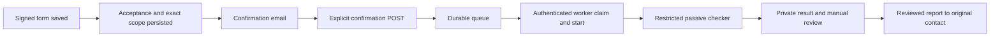

# WordPress free-scan integration

This integration connects a saved, signed CompleteTech free-scan request to a
single passive PHP2Shell check. It consists of the MU plugin in
`integrations/wordpress/`, the Python controller and restricted network adapter
in `integrations/worker/`, and the deployment files in `deployment/`.

The standalone checker retains its existing behavior. Do not expose its CLI
directly to form inputs. The integration checks the website's public homepage
and robots policy; it does not implement the broader manual security review.



## Safety and delivery semantics

- The queue is populated only by the explicit `ct_promo_request_ready` action.
  Editing a post or sending a notification does not start a scan. Old requests
  are not imported. The target, original contact and accepted terms are copied
  into the job rather than read from later edits to request text.
- Confirmation tokens are hashed at rest, short lived, and consumed by an
  explicit POST. GET requests, including email-security prefetches, cannot
  confirm. Mailbox control is not independent proof of domain ownership.
- The confirmation email also carries a separate Stop link, also hashed at
  rest. GET only shows a Stop form; a nonce-protected POST cancels the job
  (`customer_stopped`) under the queue lock. Claims, starts, results and
  request admissions then refuse it (see "Per-request admission"). A request
  already admitted when the Stop is recorded may finish within its ten-second
  timeout; no further request is admitted. Stopping a finished job changes
  nothing and does not block its report. Schema 2 added `stop_token_hash`;
  upgrades run automatically on `init`.
- Jobs have atomic claims. A claim that was never started can be recovered;
  a started job with an uncertain outcome is not automatically scanned again.
  A lost result acknowledgement retries the stored receipt, not the scan.
- The adapter pins each connection to a validated public IP while retaining the
  original hostname for TLS verification and SNI. All DNS answers must pass;
  every page and robots request is checked. Proxies are disabled. Another host,
  including a `www` variant, requires new authorization.
- The worker only receives one normalized homepage, an opaque lease, and scope
  identifiers. It receives no customer email, WordPress password, database
  password or SMTP secret. The scanner subprocess drops privileges and does
  not receive the worker authentication key.
- `potentially_affected`, `fixed_version_reported`, and `unknown` retain their
  original meanings. Exploitability is always `not_tested`. Unknown, blocked,
  timed-out or malformed results never become a safety verdict.
- Completing the automated portion does not complete the promised full review.
  The other checks remain manual work. Report transport acceptance and confirmed
  delivery are distinct, as are report delivery and scanner completion.

## Worker protocol

The four POST routes are `claim`, `start`, `admit` and `result`, under
`/wp-json/ct-scan/v1/`.
Each request carries `X-CT-Timestamp` (Unix seconds), `X-CT-Nonce` (32 lowercase
hex characters), and `X-CT-Signature` (HMAC-SHA256 hex). The signed string is the
timestamp, nonce, `POST`, route without `/wp-json`, and raw-body SHA-256 joined
with newlines. Timestamps have a five-minute tolerance; nonces are consumed
atomically. Bodies are bounded to 64 KiB and only exact permitted fields are
accepted. Protect the worker key as an execution credential.

`claim` accepts `{}` and returns `{"job":null}` or one job containing `id`,
`target`, `scope_hash`, `terms_hash`, `expires_at`, `lease` and `lease_until`.
Both expiry fields are integer Unix seconds. `start` accepts `id`, `lease`
and `scope_hash`. `result` accepts those plus `outcome`, `result`, `error` and
`checker_revision`. A completed result has `error:""`; a failed result has
`result:null` and a safe error category. Acknowledgements are `{"ok":true}`.
The scan output is bounded to 32 KiB. A replayed identical receipt is accepted
idempotently; changing its contents is a conflict.

## Per-request admission

The scanner subprocess holds no key. Before every connection to the customer's
site it asks the root supervisor over a private socket pair; the supervisor
calls the signed `admit` route; WordPress decides under the same queue lock
that serializes Stop, operator revocation, expiry, claims, starts and results.
`admit` accepts `id`, `lease`, `scope_hash` and `kind` (`http` or `probe`).

`http` is granted only if all of these hold at that moment: the job is
`running` with the presented lease and scope hash, the lease has not lapsed,
the recipient was confirmed, the saved authorization still reads back
unchanged and unexpired (including operator revocation), the job's frozen
profile is known, the previous grant is at least one second old, and fewer than
the profile's budget of requests (20 for `r2-header-v1`: robots.txt up to six
hops plus the homepage up to six hops with one HTTP-to-HTTPS change) were
reserved. The reservation and its time are written in the same compare-and-set
update as the decision, so a lost worker lease, a duplicate delivery or a
restart cannot create a fresh budget. A grant is consumed when issued, is
valid for one second and covers one connection and one request. `probe` only
reports whether the job is still live; it takes no budget and has no pacing.
Refusals use `410` (permanent: cancelled, expired, revoked, lease, profile,
unconfirmed, clock anomaly), `409` (`budget_exhausted`), `429` (`rate_wait`
with `retry_after_ms`, bounded retries) and `503` (`queue_busy`, the lock is
held elsewhere). A `503` for a disabled integration or a schema mismatch also
refuses. Nothing is admitted unless WordPress says so.

Enforcement in the supervisor and scanner:

- No grant, no connection: the network adapter asks for admission after
  destination validation and before opening any socket, re-checks that the
  grant is under one second old immediately before connecting, and reports
  completion. A scanner started without the supervisor socket refuses to run,
  and a refused admission ends the run as a failure (`admission_<reason>`), not
  as an ordinary fetch error.
- Requests and replies on the socket carry a sequence number and any channel
  error poisons the channel, so a late reply can never be read as the answer to
  a later request. Every supervisor call to WordPress has a four-second wall
  clock budget (a slower store is a refusal); one admission, including bounded
  pacing and busy retries, takes at most about eight seconds.
- The grant's one-second lifetime and ten-second request bound are measured
  from just before the call WordPress granted, not from delivery to the
  scanner. A grant that took more than 0.6 s to come back is discarded and
  asked for again (the discarded slot stays spent), at most twice; after that
  the admission is refused (`admission_expired`). No admission is requested
  after the scan's own deadline, and a shutdown interrupts a slow guard call.
- One grant is outstanding at a time. A second request, an out-of-sequence or
  unexpected message or an oversized message ends the scan
  (`admission_protocol_violation`).
- The supervisor kills the scanner when a request is not reported finished
  within the ten-second bound plus one second of grace
  (`request_deadline_exceeded`).
- While the scanner runs, the supervisor probes the job about every two seconds
  on a separate thread (so a slow store cannot delay the deadline or the kill),
  including during backoff, and kills the scanner as soon as WordPress reports
  that the job is cancelled, expired or revoked, or that the integration is
  disabled (the operator kill switch). Cancellation therefore aborts the one
  admitted request within about two seconds plus the probe's own latency, and
  never later than the ten-second bound. A probe that cannot reach WordPress
  does not abort a request already admitted, and the next admission fails closed
  (`admission_guard_unavailable`). Expired authorization is refused locally
  without a call.
- `SubprocessRunner.run` refuses to start without a gate.

A refusal fails the run with an `admission_<reason>` category (for example
`admission_job_cancelled`, `admission_budget_exhausted`). The result for a job
already cancelled is rejected by WordPress as before. A budget or time stop is
a failed receipt, never a clean result, and no automatic rescan follows. A job
that was already running when the schema is upgraded to version 3 has no record
of what it sent, so it receives no fresh budget (its admissions are refused).

What this does not do: it cannot constrain a compromised scanner that ignores
the protocol and opens its own sockets. The unprivileged UID and the
memory/process limits help, but egress filtering at the host or container
network layer (allow only the customer's HTTP/80 and HTTPS/443 destinations,
deny private, link-local and metadata ranges) is the necessary second boundary.
`deployment/compose.yaml` does not itself enforce it; that is a deployment
responsibility. DNS lookups of the already authorized hostname happen before
admission and are not treated as target requests. The supervisor therefore also
enforces the deadline and the stop by killing the scanner's process group.
Admission answers are protected by TLS to the fixed API origin but are not
themselves signed; a party able to forge that TLS session could mint grants,
which the egress boundary above still limits.

Receipt retries stop at authorization expiry or one hour after lease expiry,
whichever comes first. Permanent rejection keeps the receipt in the private
quarantine for operator reconciliation; it never initiates a new scan.
Quarantine is bounded to 100 receipts and at most one year. Inspect its reason
and the WordPress job before taking any manual action. Do not copy these
records into public issues or logs.

Before upgrading the pinned revision or rotating the key, stop accepting new
work, drain/reconcile existing receipts and stop the controller. Do not change
the expected revision while old receipts are awaiting acknowledgement.

## Bound acceptance evidence and the accepted copy

A request is queued only if its saved acceptance reads back completely. A
**bound** acceptance additionally retains the exact terms bytes the signer was
shown and the exact Target Summary, each next to the digest the signer's form
carried. The site recorder writes these post meta keys:

| Key | Meaning |
|---|---|
| `_ct_terms_binding` | `1` marks the acceptance as bound |
| `_ct_terms_snapshot` | the terms bytes as displayed (at most 512 KiB) |
| `_ct_terms_sha256` | SHA-256 of those bytes |
| `_ct_terms_shown_digest` | the digest the rendered form carried; must equal the hash |
| `_ct_summary_text` | the Target Summary as displayed, `Label: value` lines (at most 8 KiB) |
| `_ct_summary_sha256`, `_ct_summary_shown_digest` | its digest, and the digest the form carried |

The Summary must contain exactly one each of `Website (scan scope)`,
`Client contact`, `Client email` (equal to the authorized request fields) and
`Profile` (the job's profile). Any missing, oversized, mismatched, stale,
repeated or partial piece refuses the job (`ct_scan_binding_mismatch` /
`ct_scan_binding_required`), and the job row stores the summary digest, so a
later edit of the retained evidence makes the authorization no longer live and
cancels a queued or running job. Config `bound_terms_versions` (default empty)
lists terms versions whose acceptance **must** be bound; an unbound acceptance
of any other version is accepted as before, but unbound pieces without the
marker are always refused. Nothing in the plugin fetches mutable page HTML.

With config `send_accepted_copy` true (default false), a successful mailbox
confirmation sends the verified contact their copy: the Target Summary, the
hashes, the filled-in copy and, for a bound acceptance, the exact terms bytes
as an attachment. It is sent at most once (the status is claimed by
compare-and-set before mail is handed off), only to the verified address, and
never to a referrer. An uncertain or failed hand-off is recorded as `unknown`
and never resent automatically; `accepted` means transport acceptance, not
receipt. A failure cannot cancel, delay or repeat a scan. The wording of that
message has not been reviewed by the owner.

## Repository and site ownership

The maintained integration is published in this repository. The CompleteTech
site is a separate WordPress control/context checkout, with production files
managed over its documented SSH alias. Read that checkout's `AGENTS.md` and
`DOMAIN_CONTEXT.md`; do not assume a local website build/deploy pipeline.

`deployment/complete-tech-site.patch` contains only the required edits to the
existing handler, acceptance recorder, form messages and terms. It preserves
the existing referral and administrator-mail logic. Its manifest records the
inspected, newline-normalized before hashes and the prepared after hashes.
Those hashes are evidence for this patch, not permission to overwrite later
changes. If production has moved, review and rebase the patch.

To prepare the patch against the inspected local site files:

```sh
python deployment/prepare_site_patch.py --source /path/to/complete.tech
```

The command writes prepared files under `.work/site/` and a patch/manifest;
it does not change the site checkout or production. It requires exact anchors
and refuses an unexpected baseline. Inspect the diff before using it.

The new terms version is `2026-10-21-r2`. It explains the confirmation step and
the automated/manual split without narrowing existing agreements. Update the
terms page and `ct_promo_terms()` together. The recorder sets `_ct_terms_saved`
only after reading back the complete acceptance. The handler stores
`_ct_scan_target`, `_ct_scan_email`, `_ct_scan_name` and `_ct_ref`, checks those
values, then emits the action.

## Runner and scheduling

The deployment uses a dedicated Docker container with Python 3.12. The base
image is pinned by digest. The source revision is supplied as
`CT_SCAN_REVISION`; build from that exact reviewed checkout. This is separate
from the checker's embedded vulnerability-rule date.

The controller polls WordPress every 15 seconds and performs maintenance with
its claims, so it does not depend on visitor-triggered WP-Cron. Docker's
`unless-stopped` policy restarts the controller after a crash or Docker restart.
The queue lives in WordPress and pending receipts live in a private named
volume. On Docker Desktop the host and Docker must stay running; a sleeping or
offline workstation delays service. Move the same deployment to an always-on
Linux Docker host if that availability is required.

The container has no published ports, no Docker socket, no host source mount,
a read-only root filesystem, memory/CPU/process limits, and only the SETUID,
SETGID and KILL capabilities needed to drop scanner privileges and terminate a
timed-out child running under a different UID. The controller's key and
spool remain root-only; the scanner runs as UID/GID 65534. This is process
isolation with a shared kernel, not a separate virtual machine.

The chosen code and integration are published under this repository's license
terms. Preserve `LICENSE`, `LICENSING.md` and copyright notices. Review the
applicable source-availability or commercial licensing arrangements for a
different deployment; do not assume the older MIT release applies.

## Validation

The Python test suite uses synthetic results, mocked DNS/transports and local
fixtures. It must not contact external targets:

```sh
python -m unittest -v
python wordpress_check.py --help
git diff --check
```

For real WordPress/database integration checks, use the disposable environment:

```sh
docker compose -p php2shell-issue6-test -f deployment/compose.test.yaml up -d --wait
docker compose -p php2shell-issue6-test -f deployment/compose.test.yaml exec -T wordpress php /work/deployment/test-bootstrap.php
docker compose -p php2shell-issue6-test -f deployment/compose.test.yaml exec -T wordpress php /work/integrations/wordpress/tests/integration.php
```

The test network is internal. Test email is intercepted in the test process.
Only the explicitly named test project may be removed afterwards. The fixed
test subnet can be overridden with `CT_TEST_SUBNET` after checking for overlap.
Never use the bootstrap file with an existing WordPress installation.

After preparing the site patch locally, also exercise the actual modified
handler and acceptance recorder against this fixture:

```sh
docker compose -p php2shell-issue6-test -f deployment/compose.test.yaml exec -T wordpress php /work/deployment/test-site-patch.php
```

This optional check needs the prepared `.work/site/` files, intercepts email,
and covers saved requests, referral attribution, the attached contract,
confirmation gating, stale/missing terms, invalid nonce, honeypot, malformed
target and failed acceptance persistence. It uses the real promotion window;
after that offer expires, refresh its fixture deliberately instead of enabling
an expired offer in production.

## Configuration and operator setup

Production enablement is a separate operation from merging this integration.
The default configuration is disabled, and no historical request sweep exists.

1. Copy `integrations/wordpress/ct-scan.php` to the site's `wp-content/mu-plugins/`.
   Use `deployment/wordpress-config.example.php` for
   `wp-content/ct-scan-private/config.php`. Install `deployment/private.htaccess`
   as that directory's `.htaccess`, make the directory mode 0700, and make its
   configuration and key mode 0600 under the PHP process's account. Verify the
   server actually denies HTTP access; `.htaccess` is specific to compatible
   Apache configurations. Do not enable the plugin until this check passes.
2. Generate a cryptographically random 32-byte-or-longer key without logging it.
   Store its text representation in `ct-scan-private/worker.key` and in a dedicated
   external Docker volume named `ct-php2shell-secrets`, at `/key` (root-owned,
   mode 0600, parent mode 0700). These must contain the same bytes after trimming
   the trailing newline. On Docker Desktop use a Linux named volume so Windows
   bind-mount permissions cannot expose the key to the scanner child.
3. Set `expected_checker_revision` to the reviewed 40-character Git commit and
   keep `enabled` false. Build from a clean checkout of that commit using the
   same value for `CT_SCAN_REVISION`. Check `git status --porcelain` first; the
   revision string is provenance, not a substitute for a clean reviewed build.
4. Build with `docker compose -p ct-php2shell -f deployment/compose.yaml build`,
   then start with the same command prefix and `up -d`. The API origin is fixed
   to `https://complete.tech`; changing sites requires a reviewed code change.
   Check for subnet conflicts before using the default worker subnet.
5. Apply the reviewed site patch/terms update, then set `enabled` true. The
   runner must authenticate successfully before accepting live submissions.
   A matching revision and key are required; mismatches fail closed.

Schema 3 adds `profile_id`, `http_admitted` and `last_admit_ms` to the jobs
table (existing rows default to `r2-header-v1` with empty counters); schema 4
adds `summary_sha256`, `accepted_copy_status` and `accepted_copy_at`. Upgrades
run on `init` and the worker API refuses requests until they complete.

The healthcheck requires a successful authenticated exchange in the last ten
minutes. Use `docker compose -p ct-php2shell -f deployment/compose.yaml ps` and
bounded `logs --tail 50` for runner health, and the Promo Requests scan panel
for queue age, authorization and report state. A healthy container does not
mean that a particular customer's scan succeeded or that email was delivered.
Docker restart policy restarts a stopped process, not an unhealthy process;
investigate persistent unhealthy state instead of automatically resetting jobs.

## Rollout and rollback

1. Read the live site files and compare them with the inspected baseline. Keep
   backups in an HTTP-denied directory. Preserve unrelated site changes.
2. Install the MU plugin and its protected private configuration while disabled.
   Keep the authentication key out of source control and logs. Verify direct
   HTTP requests cannot retrieve any configuration or backup file.
3. Apply the reviewed handler/terms/form patch and update the published terms
   page in the same maintenance window. Preserve old request contracts.
4. Provision the controller's root-only key volume, build the reviewed revision,
   start the worker, then enable new submissions. Verify authenticated idle
   polling, replay rejection and a controlled fixture receipt. Do not backfill
   leads or scan prospects as a deployment test.
5. Check queue ages and failed/unknown outcomes in Promo Requests. Check runner
   health independently of customer-result status. Validate private result
   access and browser confirmation behavior before considering rollout complete.

To stop new work, disable the integration configuration and stop only this
Compose project. Preserve its receipt volume and WordPress queue for
reconciliation. Revoke/cancel affected authorization before any later restart.
Do not delete running-job records to make the queue look healthy. To restore
site files, restore the scoped backups; existing accepted contracts and queue
evidence must remain available. A started job with a missing receipt needs
operator investigation, not a blind retry.

Retention follows the accepted policy: scan results twelve months, and request
and acceptance records three years. Maintenance must preserve current work and
must not delete unrelated WordPress content. Authentication replay records and
bounded controller logs have shorter operational lifetimes.
